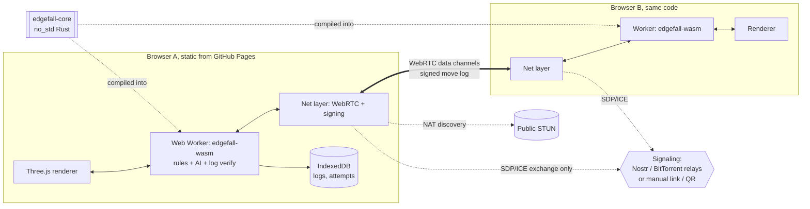

# Tech architecture and stack

Status: draft v0, for issue #17. Spec only, no code. Feature issues are listed in section 12.
Reworked after owner decision #36 (no server, P2P). Version facts below were checked on 2026-10-23 by web search. Where a source was secondary
(blog, distro tracker) it is marked **unverified**: pin versions from crates.io / npm when
Phase 0 starts.

## 1. Principles

1. One rules engine, written once in Rust, used by every peer (WASM), the CLI, the AI and the tests.
2. No server. Every peer runs the same deterministic engine and validates every move (#36).
3. Boring where it hurts (netcode, persistence: WebRTC, IndexedDB), fancy where it shows (renderer, AI, atmosphere).
4. Every hyped tech gets a verdict in section 11, so nobody re-debates it.

## 2. Architecture

Decision [#36](https://github.com/TidyMaze/ab-alone/issues/36): everything is static on GitHub
Pages, no game server, multiplayer is peer to peer (WebRTC data channels). Every peer runs the
same deterministic `edgefall-core` WASM and validates every move.



Repo layout (when code starts, not now): `crates/edgefall-core`, `crates/edgefall-wasm`,
`crates/edgefall-cli`, `client/` (Vite + TypeScript), `docs/`. One Cargo workspace, one `client/`
package. No server crate. Anything that needs a trusted server (accounts, ranking, global
leaderboard) is out of scope, see section 13.

## 3. Rust crate `edgefall-core`

`no_std` friendly (`alloc` optional), no I/O, no clock, no global RNG, no threads. Fully
deterministic: same state plus same move gives the same state on every target. That property is
what makes prediction, replays and anti-cheat work.

**Representation (described, not coded).** Board of 61 cells, axial `(q, r)`. State is a compact
value type: two 61-bit bitboards (one per side, `u64` each) plus ejected counts and side to move.
For N-player arenas (radius 8, 217 cells) the state becomes a cell array with player ids, behind
the same API. Zobrist hash maintained incrementally.

**Public API shape**

| Area | Capability |
|---|---|
| Types | `Coord`, `Direction` (6), `Cell`, `Move` (group of 1..3 marbles in line, direction), `GameState`, `Outcome` |
| Query | `legal_moves(state)`, `is_legal(state, move)`, `cell(state, coord)`, `outcome(state)` |
| Transition | `apply(state, move)` returning new state plus an `Effects` list (slides, pushes, ejections) for the renderer |
| Reversibility | `undo` via returned undo token (needed by search) |
| Identity | `hash(state)`, canonical serialisation (stable, versioned binary + JSON) |
| Variants | `Ruleset` value: board radius, start layout (standard, Belgian daisy, custom), win threshold, hooks for modes (crumbling edges, hull breach) |
| Rounds | `resolve_round(state, orders)` for simultaneous play (battle royale), pure and order-independent |
| Notation | parse and print moves in a human format, used by logs, tests, CLI |

Modes add rules through `Ruleset`, they never fork the engine (SPEC section 2). `Effects` is the
only channel between engine and animation: the renderer never infers what happened by diffing.

Features: `serde` (off in `no_std` core build), `wasm` lives in a separate crate so the core has
zero wasm dependencies.

## 4. WASM build and JS bridge

- Crate `edgefall-wasm` wraps the core with `wasm-bindgen`, built by `wasm-pack` (or plain
  `cargo build --target wasm32-unknown-unknown` plus `wasm-bindgen` CLI in CI). Latest seen:
  wasm-bindgen 0.2.129 and wasm-pack 0.15.0, both **unverified** (distro trackers, see
  [Debian tracker](https://tracker.debian.org/pkg/wasm-bindgen),
  [MSYS2](https://packages.msys2.org/packages/mingw-w64-clang-x86_64-wasm-pack)). Pin the exact
  version, the wasm-bindgen crate and CLI must match.
- The engine runs in a **Web Worker**. The main thread (render loop) never blocks on search.
- Bridge contract: JSON or a compact binary encoding, versioned, with generated TS types
  (`tsify` or `ts-rs`). Moves in, `{state, effects}` out. No object handles cross the boundary
  except one opaque engine instance per worker.
- Size budget: core + AI under 500 KB gzipped, `wasm-opt -O3`, reported in CI. Other assets: see the budget in section 9.
- Threads in wasm (SharedArrayBuffer) are **not** used at first: needs COOP/COEP headers, which
  GitHub Pages does not let us set. See section 9.

## 5. Renderer (comment on #14)

Three.js, TypeScript, Vite. Renderer behind a thin interface so scenes do not import backend
details.

**WebGPU vs WebGL.** Browser support is now broad: web.dev reports WebGPU in Chrome, Edge,
Firefox 141+ (Windows) and Safari 26, see
[web.dev](https://web.dev/blog/webgpu-supported-major-browsers?hl=en). Coverage is uneven on
Linux, Android and Intel Macs for Firefox (secondary sources, **unverified**). three.js
`WebGPURenderer` falls back to a WebGL2 backend automatically and the project states its focus is
on this renderer, see the [three.js manual](https://threejs.org/manual/en/webgpurenderer). I could
not confirm the current three.js release number or its "production ready" status from a primary
source: check the GitHub releases page when Phase 1 starts.

**Recommendation for #14:** `WebGPURenderer` with automatic fallback, from day one. We need the
fallback anyway, and writing materials in TSL (three's shader language, compiles to WGSL and
GLSL) avoids a second rewrite. Gate: if a visual feature cannot be done in both backends, it
degrades (fog and bloom stay, compute-based extras are WebGPU only and optional).

Scene notes: instanced meshes for marbles (one per look) and for the cells and their bevels (two
meshes; the discs stay on a layer the camera skips, for picking, #885), 76 dynamic lights, culled
per pixel on WebGL: a pixel shades a point light only inside its cutoff distance (#882,
`client/src/culledlighting.ts`), fog and flicker as the Dead Space mood, post-processing chain with a single "clear
board" toggle that disables it (accessibility, SPEC section 5). Animations are driven by the
engine's `Effects` list, as timelines, so replays are free.

### 5.1 Post chain and quality tiers

Post chain, in order, built with three's node/TSL post-processing so one definition compiles to
both backends (to confirm per effect in a spike, see #31): scene fog (height and edge weighted:
denser toward the board rim, never over the playable cells, a mask pass keeps cells clear),
bloom, film grain, vignette, light flicker (driven by a seeded VFX clock, not the engine). Each
deck has a lighting preset (data, not code).

| Tier | Backend | Contents |
|---|---|---|
| Full | WebGPU / desktop high tier | Whole chain, PMREM reflections, 32-segment discs & 32x16 spheres, DPR up to 1.5, stepped down a quarter (floor 1.0) while the median frame takes over 20 ms (#843), MSAA only on a touch screen, whose tiled GPU resolves it in tile memory (#868, `client/src/main.ts`); FXAA ends the post-process under a drawn ratio of 1.5 (#857, `smoothEdges` in `client/src/quality.ts`), bloom blurred at quarter resolution, every second frame (#844, #894) |
| Normal | user choice (Settings, Quality: Normal, #1715) | All of Full but its two costliest passes: no sun's shadow (#1364) and no PMREM reflections |
| Reduced | weak device (under 4 cores or under 4 GB), reduced motion or user choice | Fog, DPR up to 1.5 like the full chain, stepped down by the same adaptive resolution (#843), 16-segment discs & 16x12 spheres, no PMREM reflections, fewer dynamic lights |
| Clear board | any | No fog, no post chain, flat lighting (SPEC section 5 toggle, also the accessibility mode), a setting in the menu behind the settings cog (#277) |

The player picks the tier in Settings, Display group: **Quality: Low, Normal or High** (Reduced, Normal, Full), a press steps to the next, stored in `ab-alone.tier` and applied at once; what the page reads at load (normal maps, mesh detail) follows at the next load. With no choice stored the tier is detected as before (Full, or Reduced on a weak device, reduced motion or a software renderer), and `?quality=low|normal|high` sets it (#1715).

Tier is picked at start from the device's cores and memory and `prefers-reduced-motion`, never
from the screen width: a phone gets the same rule as a desktop (#882). The detected tier is not
stored; only a tier asked for (`?quality=low|high`) is, under `ab-alone.tier`
(`client/src/quality.ts`). Degradation is a table, not an accident: a feature not in the tier is
off, never half-broken.

**Photosensitivity.** A flash limiter sits in the post chain and the flicker driver: luminance
changes are clamped to at most 3 flashes per second and a bounded area (WCAG 2.3.1). The
renderer reads `prefers-reduced-motion` as the default (reduced tier, no screen shake, no
flicker, shorter ejection animation) and the ejection VFX (#24) must ship a reduced variant. A
safe-mode switch in the first-screen options forces both.

### 5.2 Effects timeline: boundaries

`Effects` (section 3) drives all animation. Rules: VFX, audio and camera **never feed back into
the engine**; visual randomness (particles, flicker, shake) uses a separate seeded RNG owned by
the client, never the engine RNG, so replays and the P2P state hash are unaffected; effect
timelines are data with a duration and can be fast-forwarded (skip, replay, reconnect catch-up
applies the log without playing every animation).

### 5.3 Diegetic HUD text and accessibility

In-scene screens need readable text at 720p and at 200% UI scale. Options: render-to-texture
from a hidden DOM, CSS3D, SDF/MSDF text. **Recommendation:** MSDF text in-scene (crisp at any
scale, no DOM texture cost, works in both backends), with a **hidden accessible DOM mirror**
(turn, score, selected group, legal moves, last event) updated from engine state and marked
`aria-live`, which also feeds the flat HUD fallback (clear-board tier). Keyboard play (design
spec #38) uses the DOM mirror for focus. Contrast and size are checked on the flat HUD first.

### 5.4 Audio

Web Audio API directly (no Howler or Tone at first: a bus graph and a few players are small, and
a lib adds weight and hides the autoplay rules). Bus graph: `music`, `ambience`, `fx`, `voice`
into a master with a limiter, one gain slider per bus (world.md section 7 sliders) and a duck
node that lowers music and ambience under audio logs. Adaptive music: 2 to 3 stem layers
crossfaded by a tension value derived from engine state (marbles left, boss phase, breach
countdown). Hub positional sound: `PannerNode` (HRTF) per source. Cue selection is a pure map
from `Effects` (push size, ejection, faction) to a cue id plus variant. Procedural audio (synth
drones, filtered noise for decompression) is welcome for ambience since it costs no download.
**Autoplay:** browsers block audio before a user gesture, so the first screen is a "start"
click, which also hosts the accessibility options. Until that screen exists, the audio context
is made on the first click, touch or key. Audio is a presentation layer only (5.2).
Tracked in #60.

### 5.5 Performance budget

Targets: 60 fps at 1080p on an integrated GPU in the full tier, 30 fps floor in the reduced
tier on a WebGL2-only low-end laptop (this answers the "WebGL2-only" question: playable, reduced
tier). Per frame: under 8 ms CPU main thread (engine and AI are in workers), under 10 ms GPU,
under 150 draw calls (instancing), memory under 500 MB. Measured by a Playwright perf test with
a fixed camera (reported, soft gate until Phase 1). Browsers throttle timers in background tabs:
P2P heartbeats, round deadlines and audio scheduling must not rely on main-thread `setTimeout`.
Run net timers in a worker and use `visibilitychange` to tell peers "away" instead of looking
dropped. WebGPU-only compute extras stay off the fog and bloom path.

### 5.6 GPU budget per mode (#1581)

`?gpustats` (dev) times every drawn frame on the GPU (timestamp queries) per mode, the scene family (`gpucost.ts`), and puts
it in `window.__renderCost.gpu` (also `window.__gpuCost`). Capture: play each mode a few seconds with `?gpustats`, then
`copy(JSON.stringify(__renderCost.gpu))` into `capture.json`; `bun run scripts/gpu-budget.ts capture.json` (in `client/`)
checks it against this table and exits 1 naming each mode over its average or p95 budget, or with no row. A backend
with no timestamp query (SwiftShader, so the CI runners) has nothing to check. Budget = the larger of A and B plus 30 %.

**The frame's time, not the sum of its passes (#1645).** On WebGPU a frame reads its passes laid on the GPU timeline:
first pass start to last pass end, overlapping passes counted once, a gap with no pass running not counted. three's own
number summed each pass's begin-to-end span, which overlap on the Apple GPU: 23 ms read for about 2 ms of work (#1641),
so the 30/40 ms rows it seeded are gone. The capture says `metric: "frame-span"`; `gpu-budget.ts` refuses any other (WebGL
keeps three's pass sum, its timer queries run one at a time, so its passes never overlap: `pass-sum`, not checked here).
Measured once, 2026-11-08, owner's Mac (Apple GPU, headless Chromium channel `chromium`, WebGPU, prod build
`vite build --mode e2e`, 1280x720), 4 runs per mode of 8 s each, a draw asked every frame, **measured under load 40 to
75** (not quiet after a 30 min wait, 24 other test processes): the four runs of a mode agree within 0.1 ms on A and B.
A: the e2e path (webdriver: ratio 0.5, a draw every 100 ms). B: the player's path (no webdriver flag, ratio 1, 60 Hz).
C: B with Chromium's `--disable-gpu-vsync --disable-frame-rate-limit`, the throughput (draws a second); no page mode does it,
the page cannot turn vsync off. The Open world draws no frame on B and C in this headless setup (as in #1641). All modes sit
well inside the 10 ms of 5.5.

| Mode | Avg budget (ms) | p95 budget (ms) | A avg / p95 (ms) | B avg / p95 (ms) | C avg / p95 (ms), draws/s |
|---|---|---|---|---|---|
| bot | 4.6 | 5 | 2.63 / 2.66 | 3.55 / 3.76 | 1.61 / 2.74, 438 |
| hub | 4.6 | 5 | not measured, the bot's budget | not measured | not measured |
| run-fight | 4.6 | 5 | 2.52 / 2.57 | 3.34 / 3.65 | 1.71 / 2.65, 479 |
| run-map | 4.6 | 5 | not measured, the bot's budget | not measured | not measured |
| royale | 4.6 | 5 | not measured, the bot's budget | not measured | not measured |
| boss | 4.6 | 5 | 2.61 / 2.63 | 3.37 / 3.73 | 1.69 / 2.32, 465 |
| world | 4 | 4.2 | 3.10 / 3.17 | no frame drawn | no frame drawn |

### 5.x Renderer support per browser (#85)

`bun run e2e:all` runs the 13 e2e specs on Chromium, Firefox and WebKit (Playwright 1.63.0, base
commit 565cab7). The HUD states which backend three picked. Chromium here is headless Playwright,
which has no WebGPU adapter, so it falls back to WebGL2. A headed desktop Chrome with a GPU may
report WebGPU instead.

| Browser | HUD renderer | Specs passed |
|---|---|---|
| Chromium (headless) | WebGL2 | 13 of 13 |
| Firefox | WebGL2 | 13 of 13 |
| WebKit (Safari engine) | WebGPU | 13 of 13 |

## 6. Peer-to-peer multiplayer (decision #36; comments on #13)

**Trust model.** No trusted party. Every peer replays every move with the same deterministic
engine, so an illegal move is rejected by all honest peers and the cheater's session is dropped.
What P2P cannot stop: a player sitting at two seats (collusion in battle royale), clock
disputes, and a modified client that only *refuses* to play. Accepted for a hobby game. There is
no hidden information in Abalone, so nothing leaks. Single-player and bosses are trusted-client.

**Transport.** WebRTC data channels, reliable and ordered (SCTP). A browser API, works on every
current browser, needs no server of ours. (WebSocket and WebTransport are dropped: both need a
server we no longer have.)

**Signaling without our server.** Two peers must swap an SDP offer/answer and ICE candidates
once, through some channel. Options:

| Option | Server of ours | Pros | Cons |
|---|---|---|---|
| Manual invite: SDP packed into a link or QR, answer sent back by the guest | none | Zero dependency, works forever | 2 copy-paste steps, bad UX for 6 players |
| Trystero over **Nostr** relays ([github](https://github.com/dmotz/trystero), [npm](https://npmjs.com/package/trystero)) | none | Join by room code, library handles it, public relays, redundancy | Depends on third-party public relays, relays can rate-limit or vanish. Nostr is the current default strategy per npm docs (**unverified** against source) |
| Trystero over BitTorrent trackers / MQTT / IPFS | none | Same API, can swap strategy | Same dependency class, tracker uptime varies |
| Trystero over Firebase / Supabase | free tier of a vendor | Reliable | Account, quota, a vendor key in the client |
| Own relay (WebSocket, tiny) | yes | Full control | Breaks decision #36 |

**Recommendation:** Trystero with the Nostr strategy (BitTorrent as automatic second strategy)
for room codes, **plus** the manual link / QR flow as an always-available fallback and for LAN
play. The signaling layer sits behind a small interface (`create_room`, `join_room`, `signal`)
so a strategy can be swapped without touching game code. Signaling carries only SDP/ICE, never
game data. Room codes are random 8+ characters, and the first message in a room is a signed
`Hello` carrying the peer's public key (see Identity).

**NAT traversal and TURN.** Public STUN (for example Google's) is free and enough for most home
networks. Estimates of sessions that need a TURN relay run from about 10 to 25 percent, mostly
symmetric NAT, carrier-grade NAT on mobile and corporate networks (vendor blogs, rough,
**unverified**, see [Forasoft](https://www.forasoft.com/learn/video-streaming/articles-streaming/nat-stun-turn-ice-webrtc)). A TURN server is a server, and static hosting cannot hide TURN credentials
in client code. Options: none; a free-tier hosted TURN with credentials public in the client
(abuse and quota risk, I found no reliable current free public TURN service, check before
relying on one); self-hosted coturn (costs money, breaks #36). **Recommendation:** v1 ships
no TURN, with STUN and a clear "cannot connect directly" screen that offers the manual flow and
a different network. Measure the failure rate with local telemetry (section 10) and revisit.

**Identity and integrity.**
- Each browser creates an Ed25519 keypair per session (WebCrypto) kept in memory plus
  IndexedDB. `Hello` binds the key to a display name and seat.
- The invite link carries the fingerprint of the creator's key (8 base64url characters of its
  SHA-256, coop-boss.md section 4, #1323): a joiner binds seat 1 only to a `Hello` of that key, so
  a peer that knows the room code cannot take the creator's seat by saying `Hello` first. Finding
  another key with the same 48 bits takes about 2^48 key pairs, far longer than a link waits.
- Every move is a signed message `{game_id, seq, prev_hash, move, sig}`. `prev_hash` chains
  moves, so the log is tamper-evident and any peer can prove who played what.
- After every move each peer checks `hash(state)` equals the sender's claimed post-state hash.
  A mismatch is a desync report, the game pauses and shows the divergence (engine bug or cheat).

**1v1 (and any turn-based mode).** Lockstep: only the side to move may send, both apply. No
host needed, no arbitration, the two engines must agree. Prediction is free (local apply is the
real apply). Rematch with colour swap is a new game on the same channel.

**Rematch (#186).** Once the game is over, each seated player may send a signed
`Rematch {game_id, pub, sig}` bound to the finished game id. It is sent only while the key of
every other seat is connected, like a move (#143). A peer refuses an ask with a bad signature, for
another game id (stale), or from a key without a seat. An ask can come before the last move on
another channel, so a peer keeps it and starts the new game only once every seated key asked and
the game is over on its own engine. The new game: id `hex(SHA-256(["rematch", old_id]))`, the same
on every peer and never an earlier id of the room; a fresh move log from the genesis hash; the
engine at the start position; the colours swapped, so the former White plays Black and moves first
(rules.md section 10.2). The seats stay bound to the same keys and `Hello` stays bound to the
room id (the id of its first game), so a reconnect works in any game of the room. A move or an ask
signed for the old game id is refused. Spectators stay spectators and follow the new game.
An ask in flight when the connection drops is lost (#198). Every peer keeps the signed asks of
every game of the room, and the catch-up (Reconnection, below) gives a late peer the asks it lacks,
of its own game and of every game it skipped, so it starts the same new games. A stale ask gets no
answer: only a `Sync` does.

**Battle royale (recommendation for #13: simultaneous, commit-reveal lockstep).**
1. Round opens at a deadline all peers compute from the round-start message (no trusted clock,
   deadlines are relative): 15 s to commit from the coordinator's start message as it reached
   each peer (OPEN-2 FINAL, #504; rules.md section 10.4), then 15 s more to reveal.
2. **Commit:** each peer broadcasts `H(order || nonce)` signed. Nobody can change their order
   after seeing others.
3. **Reveal:** once all live peers committed (or the deadline passed: missing = `hold`), each
   broadcasts `order || nonce`. Peers verify against the commit. A bad reveal counts as `hold`
   and flags the peer.
   Built in #500 (`client/src/royale-round.ts`, not wired yet): an order is a move record of 8
   integers, an empty one is `hold`. `Commit {game, round, hash, pub, sig}` with
   `hash = SHA-256(JSON [order, nonce])` and a random 32-byte nonce, then
   `Reveal {game, round, order, nonce, pub, sig}`, both signed like a move record whose game names
   the kind (`commit:<id>`, `reveal:<id>`), so neither can pass for a move. A peer keeps the first
   commit of each live seat, for its game and round, until the reveal starts. The round has a
   second, reveal deadline: a committed seat without a matching reveal by then holds and is
   flagged. A reveal that cannot be pinned on a committed seat (bad signature, no commit) is
   refused and flags nobody; a signed one that does not match flags its sender.
   **Equivocation (#532): forwarding, not a hash comparison.** A seat may send other commits or
   reveals to other peers. Comparing a hash of the round before resolving would only show that the
   peers differ, and agreeing on a fix would need one more exchange; forwarding makes them hold the
   same set. Each peer forwards to every other peer each commit and reveal it keeps, the moment it
   keeps it, and sends its own reveal once its reveal starts. Channels are reliable and ordered,
   so whatever a seat forwarded before its reveal reaches every peer before that reveal. Rules:
   - Two different signed commits of one key are the proof it equivocated: the seat holds and is
     flagged, whatever it reveals. A second commit counts before this peer's reveal starts, or
     later only when another seat forwards it before that seat's reveal reached this peer. One
     that comes later (from its author, or after the forwarder's reveal) is refused: some peers
     may have resolved already.
   - A matching reveal fixes the order, whoever forwarded it (the commit binds it, so there is
     only one), and a bad reveal does not stop a matching one coming later.
   - A peer gives the orders early only once every committed seat sent it its own matching reveal
     (or is proven to equivocate), otherwise at the reveal deadline.

   So when every message arrives before the deadlines, every honest peer gives the same orders.
   Left: a message that misses a deadline on some peers only, and two colluding seats (one forwards
   the other's second commit to some peers), can still split them; the state hash check then shows
   the desync.
4. **Resolve:** every peer runs `resolve_round(state, orders)` locally. It applies the orders
   one by one in a rotating initiative order (derived from round number and seat list), each
   validated at its turn, an invalid order becomes a pass (game design #53, option C). Pure, so
   all peers reach the same state, checked by hash. Bots: orders are a pure function of
   (round-start state, seed), computed before reveal.
   Built in #494 and #495 (`crates/edgefall-core/src/royale/`):
   `royale::start(seats)` gives the start position, `resolve_round(state, orders)` takes one
   `(seat, Move | Hold)` per seat in any order and returns the next state and the round log;
   `Royale::hash` is the state hash the peers compare. Since #496 each round ends with the hull
   breach, and `Royale::winners` gives the winners once the game is over. Since #497
   `Royale::standings` gives each seat its place and points (`royale/score.rs`).
   Since #498 `royale::bot::order(state, seat, seed)` gives a bot seat its order (eject if it
   can, else keep off cracked and rim cells and move toward the centre), and
   `cargo run --release --example royale_sim` runs the anti-kingmaking check of rules.md 10.4.
   Since #499 the wasm bridge exposes it as `Royale` (`new(seats, seed)`, `board`, `resolve`,
   `round_log`, `cracks`, `state_hash`, `bot_order`, `placement`, and since #502 `legal_orders`),
   encodings in the module docs of `crates/edgefall-wasm/src/lib.rs`. The offline battle royale
   (#502, `client/src/royale.ts`) plays the player against 5 bots on it, with no commit-reveal.
- **Who arbitrates?** Nobody has authority over the outcome, the pure function does. A
  **coordinator** (the host peer) exists only for liveness: it announces round start, collects
  the timeout decision and drives membership. If the coordinator lies about a deadline, peers
  fall back to their local deadline. This keeps the host from becoming a cheating vector.
- Topology: full mesh, at most 6 players means 15 connections, which is fine for tiny messages.
- Conflict rules (two orders on one cell, push versus move) are game design, see #13 and #49.
- **Built in #504** (`client/src/royale-net.ts`), over the room's session: a room has 6 seats, a
  joiner asks seat 2 and the creator binds the first free one. The coordinator sends
  `start {round, seats}`; the first one fixes the keys by arena seat, a seat empty then is a bot.
  Every peer computes the bots' orders from the round-start state with the room's seed (FNV-1a of
  the room id) and resolves the round once it has every committed seat's reveal from that seat, or
  at the reveal deadline (`RoundBook`, #500). It forwards every commit and reveal it keeps. The
  coordinator starts the next round once the round resolved on its screen. After each round a peer
  sends `hash {round, hash}`; one that differs from its own is a desync, shown on the plate (the
  game goes on). Only the hash of a key in the start's seats counts (#1322). A peer whose
  transport is closed when a deadline passes does not resolve that round. A peer whose connection opens again, or that gets a start beyond its next round (or after
  such a round), sends `behind {round}`; a peer that has more answers it alone with `played`: the
  signed commits and reveals it kept of every round from there and of the round open now. Any peer
  may answer, so a `played` counts only when its seats are the start's, or in the lobby the
  session's roster; anything else changes nothing (#1322). The late
  peer replays each round through a fresh book past its deadlines and takes what it lacks of the
  open one, so a peer back after a drop of any length catches up. The two rounds of grace
  (Reconnection below, #674) count missed commits, the same on every peer: a seat with no commit
  in a resolved round missed it, and a seat that missed the 2 rounds before is played by the bot,
  its order from the round-start state with the room's seed like an empty seat's, in every round
  it commits nothing. Its first commit after that (a peer back, or a player silent so far) plays
  its own order again and resets the count. A peer back from a drop replays the rounds it missed
  the same way, so the hashes stay equal, and retakes its seat at the next round it commits in.
  The seat stays in each round's book, so a round waits its deadline for it. The plate counts the
  order deadline down (#673, ui.md). Not done: nothing stops a peer that ignores the deadline of
  a coordinator who lies.

**Host / coordinator migration.** State is fully replicated, so the host holds no unique data.
When the coordinator's channel drops (heartbeat 5 s, three misses), the live peer with the
lowest `join_seq` becomes coordinator, announces it, and every peer acknowledges. Same
deterministic rule on every peer, so no election round is needed. In 1v1 there is no host.
Built in #359, for the peers a room has today (two seats plus spectators): every peer sends a
`beat` every 5 s. The creator is coordinator and publishes the join order in its signed `Hello`
(`order`, `join_seq` is the place in it, the creator is 1). Three beats missed, or a dropped
channel, remove a peer from the live set; a coordinator out of it is replaced by the live key
with the lowest `join_seq`, in at most 16 s after its last beat. The new one sends a signed
`coordinator` message naming itself, every other peer answers with the same message naming the
coordinator it follows. A peer that drops meanwhile is not waited for, and a new coordinator that
drops hands over again to the next `join_seq`. A room of two peers never migrates. Not done yet:
the new coordinator does not bind seats for later joiners (the creator's roster stays), and a
late joiner only learns the order from the creator's `Hello`.

**Reconnection.** A peer that drops keeps its keypair and seat for a grace period (default 60 s
in 1v1, 2 rounds in royale, tunable; timer is local to each peer, so disagreement possible, in
which case the coordinator's decision applies and is logged). It returns through the same room
code, proves its key, and any live peer sends the move log tail from its last `seq`. A page
reload resumes from IndexedDB. If everyone leaves, the game is lost unless a peer saved it, so
each peer persists the log locally and a finished or abandoned game can be exported or resumed
by the same pair.

**Catch-up (#226).** After its `Hello`, a peer sends `Sync {game_id, seq, asked}`: the game of the
room it is in, how many moves of it it has (the `seq` of the first one it lacks), and the keys
whose rematch ask of that game it holds. A joiner sends it once it has the creator's roster, since
what answers it is checked against the seats. `Sync` is not signed: it changes nothing, and all
that answers it is signed. A peer that has more answers that peer alone, once per `Sync`, with one
`Missed {of}` per signed move record or rematch ask it missed, in order: the records of its game
from its `seq` and the asks of that game it lacks, then every record and every ask of each later
game. A peer that is not behind gets nothing, nor one in a game the answering peer never had (it
is ahead), and nothing answers a `Missed`, so two up-to-date peers never loop. The late peer checks
each record and ask exactly as a live one (signature, hash chain, seat, turn, engine, and an ask
starts the new game only once the game is over on its own engine), so it derives the same game ids
and ends in the same game at the same ply. Nothing it cannot verify is applied. The moves of an
answer show at once, without their ejection effect and sound (#232, section 5.2): the board, the
ejected marbles and the score are those of the caught-up ply. A `Missed` it already has (another
peer answered too, or the live message came first) is skipped, not refused.
A live record or ask ahead of its log (a `seq` past its head, or a game id it never had) is
refused and also makes it send its `Sync` again, so a move that overtakes the answer is not lost.
A refused `Missed` never does, so a bad answer cannot make it loop. Messages stay small: no state,
only the signed log and the asks, one per message.

**Spectators.** Join the room as read-only peers (no seat, no signing rights). To avoid a mesh
of N spectators, each connects to one or two seated peers that forward the signed log (relay
tree, peers cap their spectators, default 4). Spectators verify signatures and replay locally,
so they trust nobody. A spectator joining mid-game catches up like a peer back after a drop
(Catch-up, above): every move and ask of the room so far, checked one by one. Beyond the cap the
room shows "full". Replays: the signed log is the replay file.

**Clock.** No server time. Chess-clock style: each peer measures its own opponent's thinking
time and both exchange timestamps; the lower claim of elapsed time for the mover is not
trusted, so time controls are **advisory** in v1 (shown, enforced only by mutual agreement on
timeout). A trustworthy clock needs a server, out of scope.

**Prediction.** Not needed: a move is applied locally the moment it is sent, since the engine is
the same everywhere. Network latency only affects when the opponent sees it.

## 7. AI and bosses

All AI lives in `edgefall-core` or a sibling crate `edgefall-ai`, runs as WASM in a Web Worker (and natively in
the CLI and in CI for self-play).

- **Alpha-beta** (negamax, iterative deepening, Zobrist transposition table, killer and history
  heuristics, move ordering by ejections then pushes). Casual AI is time-boxed (`search(state, budget_ms)`); **bosses are depth or node limited** so a
  retry with the same seed plays the same game on every machine. Boss hooks run inside `apply`
  so the search sees them.
  Eval trait, first impl hand-tuned: ejection difference, centre distance, cohesion, edge danger.
  This is enough for the 2-player Phase 3 bosses.
- **MCTS** for N-player arenas and royale, where alpha-beta does not apply cleanly. Later.
- **Learned eval.** Train a small value network on self-play from the alpha-beta engine, ship as
  a quantized MLP evaluated in plain Rust (no ML runtime in the browser). Later, only if the
  hand-tuned eval plateaus. Verdict "Later" in section 11.
- **Boss = search + personality.** Depth, eval weights and a script of phase changes (SPEC
  section 4). The "tell" is the engine announcing a planned special move one turn ahead, so the
  boss API needs `plan_special(state) -> Option<Telegraph>` next to `best_move`. Playtest logs
  (win rate per attempt) are stored for tuning, see persistence.
- Determinism: bosses use a seeded RNG so a run can be replayed from the log.

## 8. Persistence

No database server. Everything is client-side.
- **IndexedDB** (via a small wrapper): signed move logs (`game`, `move_log`), boss `attempt`
  records for the souls-like tuning (boss id, outcome, move count), settings, the session
  keypair. A game is its ruleset + seed + signed log.
- **Saved local game** (#218, client/src/savegame.ts): a local game, hot-seat (`?bot=off`) or
  against the bot, is saved after every move in the database `ab-alone`, object store `game`, key
  `local`. On the next load the engine replays it and the page shows it at the same ply, side to
  move and score (the bot answers if it was its turn). A finished game deletes the save, so the
  next load starts a new game. The New game button (#230, ui.md section 4) deletes it too, only
  the save of the game it leaves. There is one saved local game. A page without `?bot=off`
  resumes it in its own mode, against the bot or hot-seat (a game of the hub's hot-seat table goes
  on with no bot, #565). A page with `?bot=off` leaves a save against the bot alone, and its first
  move replaces it. Online and boss games are not saved (online needs the log catch-up of #34). A save that does not decode (unknown `version`,
  `mode` or `layout`, a bad record) or does not replay (a move the engine refuses, a finished game)
  is deleted, never shown half-done. A storage error loses the save, never the game. The format is
  versioned and minimal, it is also the export file of #219:

  ```json
  { "version": 1, "mode": "local", "layout": "standard", "bot": true, "moves": [[1, 4, 0, 2, 0, 0, 0, 0]] }
  ```

  `moves` holds the move records of the WASM bridge in play order, Black first: 8 integers
  `[n, dir, q0, r0, q1, r1, q2, r2]` (encodings in the header of crates/edgefall-wasm/src/lib.rs).
  A new layout (Belgian daisy, #69) or mode gets its own `layout` or `mode` value, a change of
  meaning a new `version`.
- **Export/import:** a game or the whole save as a JSON file (also the bug report format and the
  backup, because browsers can clear storage). `navigator.storage.persist()` is requested once per
  page view, at the first saved move; a refusal changes nothing.
- **Game file** (#219, client/src/gamefile.ts): Export game downloads the current local game, in
  progress or finished, as `edgefall-2026-10-24.json` (the player's local date), in the save
  format above on one line. Import game opens the browser's file picker. The file (1 MiB at most)
  is decoded and replayed through the engine, the only judge. A good file replaces the local game,
  shows it at its last ply and is saved like a game played here: a finished game shows its result
  and is not saved. It goes on in the page's own mode, against the bot or hot-seat with
  `?bot=off`, whatever its `bot` value says. A bad file is refused with a short HUD note and the
  game stays as it was: "import refused: not a game file" (not JSON, too big, no `version`,
  another `mode` or `layout`, a bad record), "import refused: unknown file version" and "import
  refused: illegal move in the file" (a move the engine refuses, a move after the end included).
  The note never quotes the file. Both buttons are hidden during online, boss and daily games.
  Online signed logs and boss attempts join the file later, with #34 and the attempt table.
- **Cross-device progress** is out of scope (no accounts, SPEC section 6). Export file is the
  workaround.
- Telemetry (boss win rate per attempt) stays local by default. An opt-in "send my attempts" can
  post to a GitHub issue template or a static form later, decided with #48.

## 9. Hosting and delivery

- **Everything on GitHub Pages**, deployed by Actions from `main`. Cost: zero.
- Pages limits to know: no custom response headers, so no COOP/COEP, so no SharedArrayBuffer
  wasm threads (not needed). Soft limits of about 1 GB site size and 100 GB per month bandwidth
  (from memory, **unverified**, check GitHub docs): keep wasm and assets small, use compressed
  textures and audio. Cloudflare Pages is an escape hatch if a header ever matters.
- **Asset pipeline (#61).** Models: glTF with meshopt compression (#701): `client/scripts/pack-models.mjs`
  (gltfpack, a pinned dev dependency) packs each Blender export of `client/models/`, outside the build, into
  `client/public/assets/pbr/`, committed; the GLTFLoader decodes it with three's MeshoptDecoder. Textures: KTX2/Basis
  (GPU-compressed, small download, #700): the PNG and JPG sources live in `client/textures/`, out
  of the build; the Vite plugin `client/scripts/ktx2-textures.mjs` encodes each one to
  `assets/<path>.ktx2` (normal maps UASTC with RDO and Zstandard, colour and data maps ETC1S, all
  with mipmaps) with `ktx2-encoder`, Basis Universal built to WebAssembly, a pinned dev
  dependency that runs the same on Linux and macOS with nothing to install. The dev server serves
  them, the build writes them. An encode is cached by the hash of its source and settings in
  `~/.cache/ab-alone-ktx2/`, shared by the checkouts and kept between CI runs. The page reads them
  with three's `KTX2Loader` once the renderer is up; its transcoder is a hashed asset of the build,
  never a CDN. Audio: Opus in WebM or Ogg, with an AAC fallback only if
  Safari needs it. Lazy loading per deck, the hub loads a first deck only. Budget (starting
  values, soft until Phase 1): initial load under 5 MB gzipped (wasm + JS + first scene), each
  deck under 15 MB, whole site under 250 MB, well below the Pages soft limits. The 5 MB counts
  what the first screen downloads before the service worker installs (page, entry JS and CSS,
  wasm, icons, shared textures, Mess textures, the KTX2 transcoder); the worker's background precache (section 9.1)
  counts only toward the 250 MB site budget. CI reports and fails on regressions: the `rust`
  job runs `vite build` then `client/scripts/size-budget.mjs`, which sums the gzipped files of
  `dist/` (a deck is its `deck-<deck>*` files), writes a table to the run summary and fails over
  a budget or when `dist/` holds a source file (`.blend`, `.wav`, `.psd`, `.kra`, `.xcf`). Source
  files stay out of the Pages artifact. Who makes assets is a design question (world spec open
  questions), and procedural or generated assets are preferred for the first decks.
- Versioning: the wire protocol and the engine carry a version number in `Hello`. Peers on
  different engine versions refuse to play (a desync otherwise). Old tabs are told to reload.
  **Engine version (#526):** `engine_version()` of the wasm, a number set by hand in
  `crates/edgefall-wasm/src/lib.rs` and bumped with any change that makes the same moves give another
  game (a rule, a boss reply, a layout). The crate version is not used: it is never bumped. Every
  `Hello` carries it in a signed `engine` field. A session refuses a `Hello` from another version,
  or from an older peer that sends none (it predates the check, so its engine may differ): no seat,
  no presence, and the HUD shows `refused move: engine-version`. The creator still answers with its
  own `Hello`, so the joiner refuses it in turn, says so, and is never seated.
  Version 4 (#740): the Magnetizer's alternating signs on both sides, the Rail Yard's first train
  on turn 2, the Alien's 7 start marbles and near eggs.
  Version 9 (#810): the Chaplain's conversions move its health, +1 player credit per boss marble
  that flips to the player and -1 per player marble that flips to the boss, and its phase never goes back.
- Only third-party runtime dependencies: public STUN, signaling relays. Both degrade to the
  manual flow, single-player never needs them.

### 9.0 Mode chunks (#1578)

The code of a mode loads when the player first enters it, with `import()`, so the entry does not parse what a player may never open.
Two chunks: the Open world (`client/src/openworldwire.ts`: its mode, view, minimap, saves and online layer, the HUD controls only it has) and the
online Battle royale (`royale-net.ts`: the room and the rounds, loaded by Invite or an invite link). The page keeps a small stand-in for the
Open world (`openworldhandle.ts`): off (not active, nothing to draw or hold) until its first `open` loads the code.

- **First screen.** The build also splits off the code the entry shares with a chunk (three.js and the modules both use), and the page preloads
  it: that is still the first screen, so `size-budget.mjs` counts every script and preload link of `index.html` (`pageScripts`), not the
  `index-*.js` name. A chunk loaded at a first entry is not counted.
- **Slow and failed loads** (`modechunk.ts`, `lazyChunk`): a load still running after 150 ms shows the Loading plate (`#loading`), a fast one flashes
  nothing. A load that fails (offline, a new deploy that removed the old file) shows `#chunk-error` with Retry and Reload over a page that is
  alive. Chromium keeps a module that failed to load for the life of the page and Vite deduplicates its preload link, so Retry asks a
  second time only where the browser allows it (Firefox); Reload always brings the file back.
- **Offline and Pages.** The chunks are hashed files of `dist/assets/`: the precache list of section 9.1 (every built file) and the Pages
  artifact (all of `client/dist`) take them with no change.
- **Not split: the rogue-lite.** `main.ts` uses 69 names of `roguelite.ts` (about 490 uses) across the run screens, and `runbook.ts` imports it
  too: its chunk needs the run wiring moved first (a task of its own).

### 9.1 Offline app (#165, #193)

The production build installs as an app and plays offline (hot-seat, bot, bosses) after one online
visit. No dependency: a hand-written service worker and a build step that lists the hashed files.

- **Manifest:** `client/public/manifest.webmanifest`. Name, `display: standalone`, theme and
  background colour `#0b0d0f` (world spec section 5), every path relative to the manifest so it
  works under the Pages base path `/edgefall/`. Icons 192 and 512 px (the 512 one also maskable)
  are drawn by `client/scripts/gen-icons.mjs` and committed; a test keeps them equal to the
  generator output.
- **Build:** after `vite build`, the plugin `client/scripts/offline-app.mjs` lists every built file
  (hashed JS, CSS, wasm and bot worker, the KTX2 textures and their transcoder, icons, manifest
  and page; not `sw.js` nor
  source maps), hashes their content, and bundles `client/src/sw.ts` into `dist/sw.js` with that
  list, the cache name `ab-alone-<16 hex of the hash>` and the Google Fonts stylesheets the built
  page links to. Any changed file gives a new cache name, so a new `sw.js`. The pure parts
  (precache list, cache name, routing, old caches, font stylesheets and font files) are in
  `client/src/offline.ts`, unit tested.
- **Install:** fetches the whole list into the build's cache, revalidated with the server
  (`cache: 'no-cache'`, never a stale HTTP cache entry), then the UI fonts (below), then takes
  over at once (`skipWaiting`). A failed fetch of the list fails the install and the previous
  build stays in charge. **Activate:** deletes the app's caches older than the previous one, keeps
  the previous one, controls the open pages. Only caches named `ab-alone-*` are touched: the Pages
  origin is shared with other sites.
- **UI fonts (#221):** Chakra Petch and IBM Plex Sans come from Google Fonts, cached by the
  worker at runtime, not committed. At install it fetches the stylesheet the page links to
  (`fonts.googleapis.com`) and every font file it points to (`fonts.gstatic.com`), with CORS (both
  hosts allow it), into the build's cache: the first visit fetched them before the worker
  controlled the page, so one online visit is enough. Best effort: a font that fails leaves the
  system font, never a failed install. The fonts live and are deleted with the build's cache, and
  the stylesheet Google serves depends on the browser, so each install fetches its own.
- **Fetch, cache first:** opening the app (the scope or its `index.html`, any query or hash) gets
  the cached page; a file of the build comes from its cache; any other URL of the scope is looked
  up in the older caches, then the network. A GET over https to the two font hosts is looked up in
  every cache of the app, newest first, then the network, and a good answer is kept in the current
  cache. No other site is touched (signaling, STUN, any other host).
- **Update:** each load calls `registration.update()` (Chrome does not check by itself on a
  reload), and so does an open tab when it comes back to the foreground and every 15 minutes
  (#1437); offline or refused, the game goes on. The new worker installs and takes over, and the
  page shows **New version: reload**. Nothing at stake: the page then reloads by itself, once per
  build (`sessionStorage` key `ab-alone-auto-reload` holds the build the page ran; no storage, no
  automatic reload). At stake, the button stays and the reload comes at the first moment nothing
  is (`client/src/autoreload.ts`): an online room, the ranked queue, a boss fight, daily or lair,
  a Battle royale, a rogue-lite or Trainer run, a replay, the Open world, the lobby sheet, a text
  field in use. A local hot-seat or bot game is not at stake: it is saved on every move and
  resumes (#218). The reloaded page runs the new build, whole. Each cache holds one build and every JS, CSS
  and wasm name carries its content hash, so a page never runs old JS with new wasm or the
  reverse. A page that loaded just before the update still finds its own files in the kept
  previous cache.
- **Not in dev or tests:** only the production build registers the worker
  (`import.meta.env.PROD`). The e2e suite blocks service workers (`serviceWorkers: 'block'`),
  except `client/e2e/offline.spec.ts`: it runs on `vite build` + `vite preview` (random port,
  under `/edgefall/`, started and stopped by `playwright.config.ts`), or on the live site with
  `E2E_BASE_URL`. It loads once, checks the fonts are cached, empties the browser's HTTP cache (it
  keeps the stylesheet a day at most), goes offline, reloads, checks the UI fonts are loaded and
  plays a bot move. The two font hosts answer from the spec (a stylesheet of the two families on a
  font file Playwright ships), never from Google: a network outage held the first load past the
  15 s timeout (bug #649).

## 10. CI, testing, observability

**CI (GitHub Actions):** `cargo fmt --check`, `clippy -D warnings`, `cargo test` (native),
`wasm-pack test --node` (wasm32), `cargo deny` / `cargo audit`, client typecheck + lint +
Vitest, build, Pages deploy on main. Toolchain pinned by `rust-toolchain.toml`, cargo cache,
target under 10 min.

**Testing strategy**
- **Property tests** (`proptest`): marble count never changes except by ejection, every
  `legal_moves` entry passes `is_legal`, `undo(apply(m)) == id`, state hash is stable, wasm and
  native agree.
- **Perft:** node counts at depth 1..N from the start position and from hand-built tricky
  positions (sumito at the edge, blocked pushes). Reference: a second implementation or a
  published table. Perft is the engine's truth test.
- **Golden games:** recorded games replayed on every build, hash compared.
- **Cross-target determinism:** same move list on native and wasm32, compare final hash.
- **Netcode:** an in-memory fake transport that drops, reorders, duplicates and delays messages
  (reconnect, double send, spectator catch-up, coordinator migration, commit-reveal with a
  silent or lying peer). Royale resolver: order-independence property. One real WebRTC
  loopback test in Playwright (two pages) in the e2e suite, run locally before every merge.
- **Renderer:** Playwright smoke test per backend (WebGPU, WebGL2), screenshot of the start board
  with tolerance. Visual changes reviewed in the PR.
- **AI:** self-play gauntlet in CI nightly, Elo vs fixed baselines, fail on regression.

**Observability (client-side only, #220):** a structured logger with levels (`debug`, `info`,
`warn`, `error`, `client/src/logger.ts`) prints each event on the console and keeps the last 1000
in a ring buffer, in memory only. An event is `{t, level, event, data}`, `t` in ms since the page
started. Events: `start` (renderer backend, quality tier), `net` (each connection state change,
and each connection failure with its cause), `refused` (a message the session refused, with its
reason), `desync` and `bot-search` (the time the bot or the boss took, with its node budget or
boss id).

Local counters (`client/src/netcounters.ts`): connections opened; failures by cause: `lost` (an
open connection closed), `signaling-timeout` (a joiner found no peer within 30 s; the room
creator waits for its opponent as long as it takes), `ice-failed` (Trystero reports that the
peers swapped their SDP but never connected) and `join-error` (any other Trystero join error);
the time to connect of each connection, from the start or from the loss of the previous one;
refused messages by reason; desync reports. Until moves carry a post-state hash (section 6), a
desync is a refused move that shows the other side's log or position is not ours: `bad-chain`,
`out-of-order`, `illegal` or `not-their-turn`. Those counters drive the TURN decision
(section 6).

The **Copy diagnostics** button (`client/src/diagnostics.ts`) puts one JSON text in the clipboard:
the app build (the commit), the environment (build mode, renderer backend, quality tier, user
agent), the current game (mode, layout, boss id and seed, online game id, side and role, side to
move, status, every move record played, and online the signed log, since the signed log
reproduces any bug), the counters and the events, one move or one event per line. When the
Clipboard API refuses, the text is shown in a box, selected, to copy by hand. The export holds
public data only (public keys, signatures, the room id): private keys are dropped from every
event and from the export, so it may be pasted into a public issue. Boss analytics come from the
local `attempt` table. No third-party SDK, no data leaves the browser unless the player exports
it.

### Closed bugs

- #1226 (three sound e2e specs red, bus gains read 0): environmental, the headless AudioContext clock of one Mac stalled; no code change, `e2e/sound.spec.ts` 11 passed on main 836fc723 and the full run of PR #1256 had no sound failure (512 passed).
- #842 (10 to 15 FPS at DPR 2): closed, the causes are fixed (#843 to #846, #848) and the Mac reads 60 FPS on the high tier. The first frame stays in #847, the weak GPU in #849.
- #885 (2x frame rate on a phone): closed unmet. #886, #887 and #895 took draw calls from 224 to 65, 1.3 to 1.4x. The rest is GPU-bound and needs a real Pixel 7 bench.
- #925 (texture download time): closed as measured, the 5 to 6 s target is withdrawn. Textures alone cannot reach it: JS, wasm and GLB are 41 % of the wire, textures 2.57 MB of 4.37 MB. Lower ETC1S quality rejected (the room looks softer). Lazy normal maps rejected (at most 20 % at 1 Mbps, still about 30 s; a visible pop of about 10 s; a pipeline recompile on WebGPU that conflicts with #847). Transcode already runs in workers.

## 11. Trending tech considered

| Tech | Verdict | Why |
|---|---|---|
| Rust + WASM engine | Adopt | The core bet: one rules engine for every peer, the CLI and tests |
| three.js WebGPURenderer + TSL | Adopt | Fallback to WebGL2 is built in, broad browser support (section 5) |
| WebRTC data channels (P2P) | Adopt | Decision #36: no server, deterministic engine on every peer validates |
| Trystero (Nostr / BitTorrent signaling) | Adopt | Serverless room codes; manual link / QR kept as fallback |
| WebSocket game server (axum) | Reject | Dropped by #36, nothing to host it |
| Own TURN server (coturn) | Reject | A server and a bill, breaks #36. Revisit only if measured failure rate hurts |
| WebTransport | Reject | Client-server only (Baseline since Safari 26.4, unverified), and we have no server. P2P WebTransport does not exist in browsers |
| Bevy (Rust engine, v0.20 seen, [bevy.org](https://bevy.org/news/)) | Reject | Asked for Three.js, and a full engine duplicates what we need; wasm size and iteration cost |
| ECS (as architecture) | Reject | 61 cells, a bitboard beats an ECS. Maybe for the hub world (Phase 5), decide then |
| WebGPU compute (particles, fog) | Later | Pure eye candy, optional, WebGPU-only, after the board works |
| Tauri desktop app | Later | Wrap the static client once the game is fun. Mobile and desktop native are out of scope today |
| CRDTs (Automerge, Yjs) | Reject | Turn-based hash-chained signed log is simpler and tamper-evident; CRDTs solve concurrent edits we do not have |
| Edge workers (Cloudflare Durable Objects) | Reject | A server by another name, breaks #36 |
| LLM-driven boss dialogue | Later | Fun for lore, but latency, cost, moderation, non-determinism. Pre-written lines first, LLM behind a flag, never in the move path |
| Learned eval / AlphaZero style net | Later | Only if hand-tuned eval plateaus; ship as plain Rust MLP, no ML runtime |
| Gaussian splats | Reject | Static captured scenes, we have a stylised synthetic ship. Heavy for no gain |
| WebXR | Reject | Not now. Cheap to revisit later since three.js supports it, but input and comfort design is a whole project |
| Web Audio API (direct) | Adopt | Bus graph, adaptive layers and HRTF panning need no lib. Howler/Tone: Later if the graph gets complex |
| Spatial audio (PannerNode HRTF) | Adopt | Hub rooms need positional sound, built into Web Audio |
| Procedural audio | Adopt | Ambience and decompression synthesized, zero download |
| MSDF text for in-scene HUD | Adopt | Readable at any scale, plus a DOM mirror for screen readers |
| KTX2 + meshopt | Adopt | Small downloads under the Pages bandwidth budget |
| Web Workers for AI | Adopt | Keeps the render loop smooth, no headers needed |
| WASM threads (SharedArrayBuffer) | Reject | Needs COOP/COEP, not possible on GitHub Pages, not needed at our search depth |
| IndexedDB + JSON export | Adopt | Only persistence available client-side, move log is tiny |
| SQLite in wasm (OPFS) | Later | Only if queries over logs get complex |
| WebCodecs / video | Reject | No video in the game, lore is audio and environment |

## 12. Feature issues derived from this spec

Issues #33, #34, #35, #39 were rewritten for P2P after #36.

| Issue | Area |
|---|---|
| #23 edgefall-core: board, move generation, validation, sumito | engine |
| #25 Engine test harness: property tests and perft | engine |
| #27 WASM build and JS bridge | engine |
| #29 AI: alpha-beta with hand-tuned eval, in a Web Worker | engine |
| #31 Three.js renderer: WebGPU with WebGL fallback | client |
| #33 P2P networking: WebRTC, serverless signaling, signed move log | client |
| #34 Reconnection, host migration, spectators, replay | client |
| #35 Battle royale: commit-reveal simultaneous rounds | engine |
| #37 CI: GitHub Actions, Pages deploy | engine |
| #60 Audio engine: Web Audio bus graph, adaptive layers, spatial hub sound | client |
| #61 Asset pipeline: glTF, KTX2, Opus, lazy loading, size budget | client |
| #39 Local persistence (IndexedDB) and client observability | client |

Suggested order: #23, #25, #37 (Phase 0), then #27, #31 (Phase 1), then #33, #34, #39 (Phase 2),
#29 (Phase 3), #35 (Phase 4).

## 13. Open questions

1. Is "cheating is detectable, not preventable" acceptable? No ranking or accounts (SPEC section
   6) makes it cheap to accept. A ranked ladder would need a server and reopens #36.
2. TURN: ship v1 without it, and what failure rate (measured locally, about 10 to 25 percent
   estimated) triggers a rethink?
3. Signaling dependency: are we fine relying on public Nostr / BitTorrent relays, with the
   manual link as fallback?
4. Time controls are advisory in v1. Is that enough for 1v1 (#41)?
5. Draw / anti-stalling rule (#12, #40) affects `outcome`, the AI and the signed log.
6. Perf targets in 5.5 are starting values: who owns the low-end reference machine?
7. Who produces the art and audio assets (world spec open question)? Drives the budget in 9.
